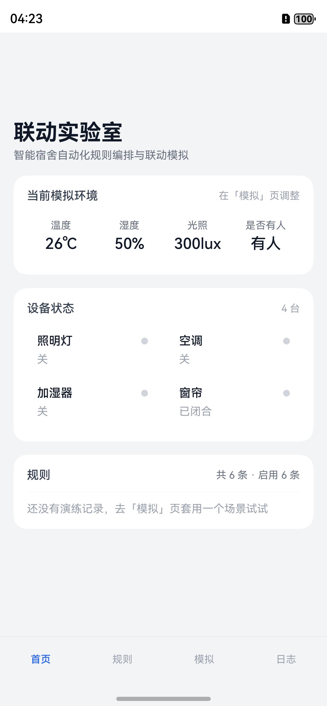
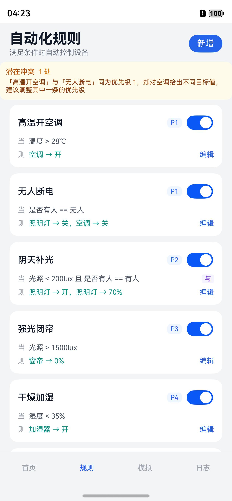
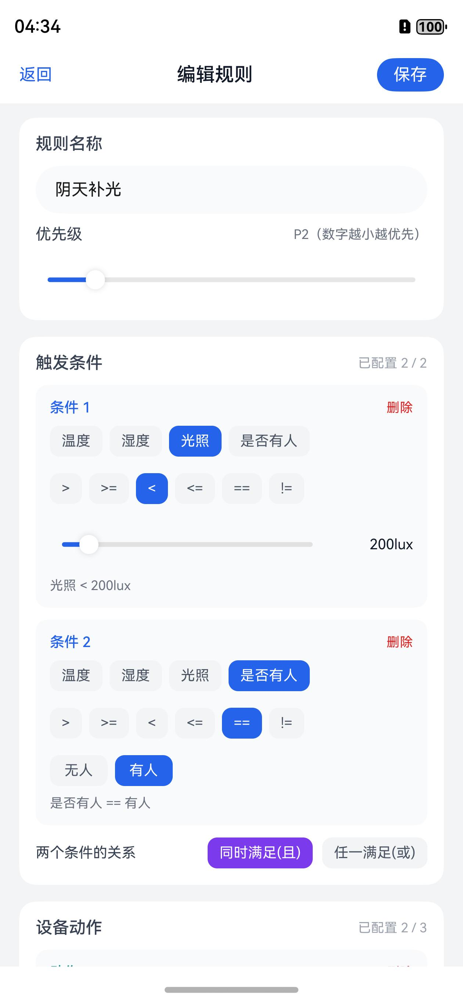
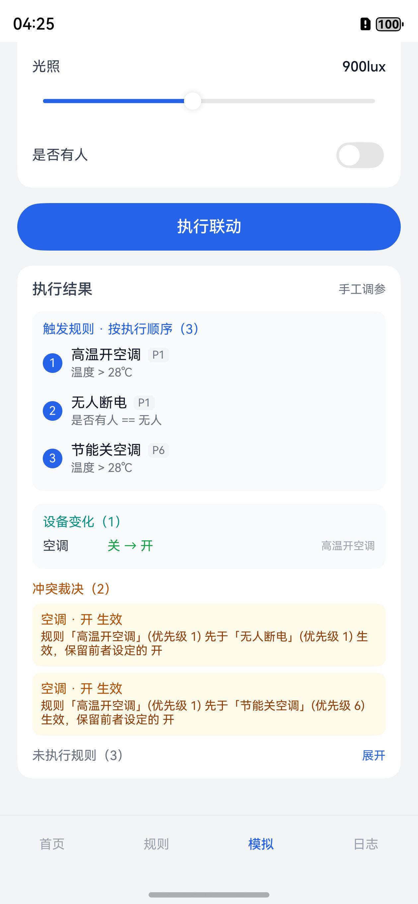
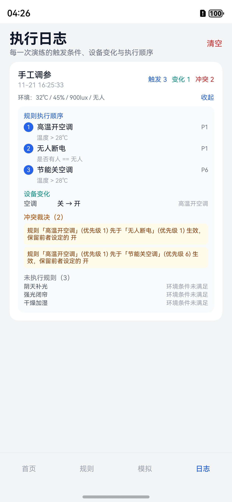
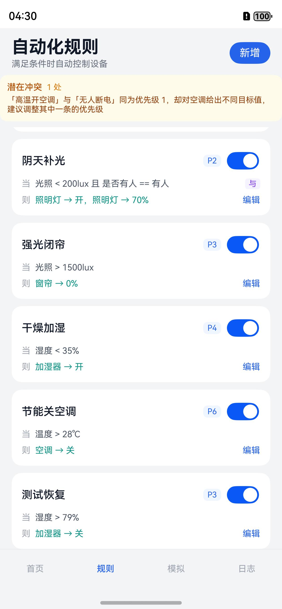
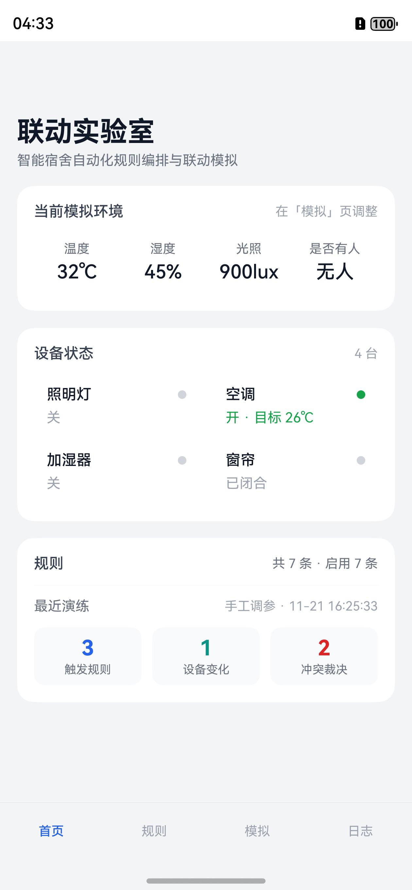

# 联动实验室（Dorm Link Lab）

面向智能宿舍的**自动化规则编排与联动模拟**应用：用户编写「满足条件就执行设备动作」的规则，在模拟环境中调节温度、湿度、光照与在寝状态，观察规则如何驱动设备，并查看每一次联动的触发顺序、设备变化与冲突裁决结果。

HarmonyOS 期末大作业 · 独立完成 · 陈俊涛 20230313102

---

## 功能

| 能力 | 说明 |
|---|---|
| 4 类可控设备 | 照明灯（开关 + 亮度）、空调（开关 + 目标温度）、加湿器（开关）、窗帘（开合度） |
| 4 项环境输入 | 温度 10–40℃、湿度 10–95%、光照 0–2000lux、是否有人 |
| 规则编排 | 新增 / 修改 / 启停 / 删除；1~2 个条件；条件间支持「且 / 或」；1~3 个设备动作；优先级 1–9 |
| 规则引擎 | 按优先级排序求值，输出触发规则、执行顺序、设备变化、冲突裁决、未执行原因 |
| 冲突处理 | 同一设备属性被多条规则争抢时，高优先级先生效且不被覆盖，冲突写入日志；同优先级冲突在列表顶部提示 |
| 场景演练 | 内置「夏季午休」「阴雨傍晚」两组场景，一键套用后执行 |
| 执行日志 | 记录每次演练的环境快照、触发条件、设备变化、执行顺序，可展开查看 |
| 本地持久化 | 规则、设备状态、环境参数、执行日志关闭进程后重启全部恢复 |

### 预置规则（首次启动）

| 优先级 | 规则 | 条件 | 动作 |
|---|---|---|---|
| P1 | 高温开空调 | 温度 > 28℃ | 空调 开 |
| P1 | 无人断电 | 是否有人 == 无人 | 照明灯 关、空调 关 |
| P2 | 阴天补光 | 光照 < 200lux **且** 有人 | 照明灯 开、亮度 70% |
| P3 | 强光闭帘 | 光照 > 1500lux | 窗帘 开合度 0% |
| P4 | 干燥加湿 | 湿度 < 35% | 加湿器 开 |
| P6 | 节能关空调 | 温度 > 28℃ | 空调 关 |

> 「节能关空调」与「高温开空调」条件相同、目标相反，用来演示冲突裁决：套用「夏季午休」场景执行后，空调保持开启，日志中出现一条冲突记录，说明 P1 规则优先。

---

## 开发环境

| 项目 | 版本 |
|---|---|
| DevEco Studio | 5.0.5(17) |
| HarmonyOS SDK | 5.0.5(17) |
| compileSdkVersion / compatibleSdkVersion | 5.0.5(17) |
| 语言 | ArkTS（API 17 严格模式） |
| 存储 | @kit.ArkData `preferences` |
| 测试 | @ohos/hypium 1.0.21 |

## 运行方法

1. 用 DevEco Studio 打开本工程根目录（`File → Open`），等待 Sync 完成；
2. 连接 HarmonyOS 真机或启动模拟器（Device Manager）；
3. 点击 `Run 'entry'`，或命令行构建：

```bash
export DEVECO_SDK_HOME="/path/to/DevEco Studio/sdk"
hvigorw --mode module -p product=default -p module=entry@default \
        -p buildMode=debug assembleHap --no-daemon
```

产物位于 `entry/build/default/outputs/default/entry-default-unsigned.hap`。

### 运行单元测试

在 DevEco Studio 中右键 `entry/src/test/RuleEngine.test.ets` → `Run 'RuleEngineTest'`；
或命令行：

```bash
hvigorw --mode module -p product=default -p module=entry@default test --no-daemon
```

覆盖率报告输出至 `entry/.test/default/outputs/test/reports/index.html`。

---

## 自动化测试

共 12 条用例，覆盖正常、边界、异常三类：

| 编号 | 类别 | 用例 | 断言要点 |
|---|---|---|---|
| T01 | 正常 | 高温开空调 | 命中 1 条，空调开关 = 1 |
| T02 | 正常 | 单规则控制两台设备 | 2 项变化，灯与空调均为 0 |
| T03 | 边界 | `>` 的等值边界（温度 28） | 不命中，skipped 原因「环境条件未满足」 |
| T04 | 边界 | `>=` 的等值边界（温度 28） | 命中 1 条 |
| T05 | 边界 | 动作值越界裁剪 | 亮度 150 → 100，-20 → 0 |
| T06 | 正常 | 双条件「与」全满足 | 命中，灯打开 |
| T07 | 正常 | 双条件「且」缺一 | 不命中 |
| T08 | 正常 | 双条件「或」任一满足 | 命中 |
| T09 | 异常 | 空条件规则 | 不命中，原因「未配置触发条件」 |
| T10 | 异常 | 停用规则 | 不命中，原因「规则已停用」 |
| T11 | 异常 | 冲突裁决 | 空调最终为开，冲突胜者 = 高温开空调 |
| T12 | 异常 | 执行顺序与副本保护 | 高优先级 order = 1，入参设备数组未被修改 |

实测覆盖率（本地单测）：`engine/RuleEngine.ets` 行覆盖 **77.5%**、分支覆盖 **58.1%**。

---

## 项目结构

```
entry/src/main/ets/
├── model/                 # 领域模型（纯数据，无外部依赖）
│   ├── DeviceModel.ets    #   设备类型、属性、状态、读写与裁剪
│   ├── EnvModel.ets       #   环境字段、比较运算符、取值范围
│   ├── RuleModel.ets      #   规则 / 条件 / 动作
│   └── LogModel.ets       #   执行结果结构
├── engine/
│   └── RuleEngine.ets     # 规则引擎：求值、排序、冲突裁决、设备推演
├── service/
│   ├── StorageService.ets # Preferences 读写与序列化
│   ├── ScenarioPresets.ets# 默认规则与两组场景
│   └── AppStore.ets       # 内存状态与落盘编排
├── view/
│   ├── DashboardView.ets  # 首页：环境 + 设备 + 最近演练
│   ├── RuleListView.ets   # 规则列表与冲突提示
│   ├── SimulatorView.ets  # 模拟演练
│   └── LogView.ets        # 执行日志
├── pages/
│   ├── Index.ets          # Tabs 容器（首页 / 规则 / 模拟 / 日志）
│   └── RuleEditPage.ets   # 规则编辑
└── common/
    ├── Formatter.ets      # 界面文案格式化
    └── Utils.ets          # 时间格式化

entry/src/test/
├── List.test.ets          # 测试套件入口
└── RuleEngine.test.ets    # 12 条引擎测试
```

---

## 设计要点

**1. 引擎纯函数化**

`RuleEngine.run()` 不修改传入的设备数组，而是先深拷贝再推演，返回 `devicesAfter` 快照。这样核心逻辑可以脱离 UI 与数据库独立测试，也是 12 条单元测试能直接跑起来的前提。

**2. 执行顺序确定性**

规则先按 `priority` 升序、再按 `ruleId` 字典序排序。同一份环境输入必然得到完全相同的执行顺序与结果，避免 `Array.sort` 不稳定带来的随机性。

**3. 冲突不是"最后一条生效"**

同一「设备:属性」维护占位记录，高优先级规则写入后，低优先级规则给出不同值时不再覆盖，而是生成一条 `ConflictRecord`。用户能明确知道"为什么最终是这个状态"。

**4. 布尔量统一为 1/0**

开关与「是否有人」在比较、记录、格式化时都用数值表示，使数值条件与布尔条件共用同一套运算符与同一套冲突判定，减少了近一半的分支代码。

**5. 领域对象用自由函数而非实例方法**

从 Preferences 反序列化出的对象没有类原型，调用实例方法会失败。因此 `cloneDevice` / `cloneEnv` / `cloneRule` 全部写成自由函数，保证内存对象与反序列化对象行为一致。

---

## 持久化说明

使用 Preferences 键值存储，四类数据分键保存，每次操作后立即 `flush()`：

| 键 | 内容 | 说明 |
|---|---|---|
| `rules` | 规则数组 JSON | 增删改后写入 |
| `devices` | 设备状态数组 JSON | 联动执行后写入 |
| `env` | 环境快照 JSON | 调参或套用场景后写入 |
| `logs` | 执行记录数组 JSON | 保留最近 8 条，剥离大字段，避免超出单值长度上限 |

若后续需要支持历史数据的条件检索（按设备、按时间段），应改用 RDB 建表，这一点已作为技术局限写入报告。

---

## 演示与录屏

录屏文件：[`docs/演示录屏.mp4`](docs/演示录屏.mp4)（时长 2 分 31 秒，模拟器实拍，未做剪辑）

覆盖的完整流程：

| 时间 | 内容 |
|---|---|
| 0:00 | 首次启动，首页展示 4 台设备状态、当前环境与最近一次演练结果 |
| 0:05 | 进入「规则」页，6 条预置规则 + 1 条新增规则，顶部提示 1 处潜在冲突 |
| 0:11 | 打开「阴天补光」编辑页，展示**双条件**配置（光照 < 200lux 且有人）与动作 |
| 0:24 | 进入「模拟」页，套用「阴雨傍晚」场景：21℃ / 82% / 120lux / 有人 |
| 0:28 | 第 1 轮执行：触发「阴天补光」「测试恢复」，照明灯 关 → 开 |
| 0:37 | 套用「夏季午休」场景：32℃ / 45% / 900lux / 有人 |
| 1:06 | 第 2 轮执行：触发「高温开空调」「节能关空调」，**空调 关 → 开**，并给出**冲突裁决 1 条**（P1 优先于 P6） |
| 1:47 | 第 3 轮执行：切到无人态后触发 3 条，**照明灯 开 → 关**，**冲突裁决 2 条**（分别对「无人断电」与「节能关空调」） |
| 2:10 | 进入「日志」页并展开最新一条记录，查看环境快照、触发条件与设备变化 |
| 2:23 | 强制结束进程后重新启动，环境、设备状态、规则与日志全部原样恢复 |

> 第 3 轮里「无人断电」与「高温开空调」同为 P1，按 `ruleId` 字典序由「高温开空调」先写入，因此空调保持开启、关灯生效 —— 这正是冲突裁决机制被观测到的场景。

## 截图

| 首页仪表盘 | 规则列表 | 规则编辑（双条件） | 模拟执行与冲突裁决 |
|---|---|---|---|
|  |  |  |  |

| 日志详情 | 重启前 | 重启后规则仍在 | 重启后首页恢复 |
|---|---|---|---|
|  |  |  |  |

> 全部截图与录屏均为模拟器 1260×2720 实拍，未做手工修饰。

---

## 许可

本项目为课程作业，仅用于学习交流。
